  

  

---

##  About Me

I'm **Riyan Fajri Ramadhan**, an aspiring software engineer from Batam, Indonesia. I study Computer Science at Universitas Ibnu Sina and I'm enrolled in the Full Stack Software Engineering program at RevoU.

I work at **HNS IT Center**, a computer and laptop hardware retailer, where I handle admin work and build internal tools that make day-to-day operations faster.

&nbsp; Admin & Developer at **HNS IT Center** 
&nbsp; Focused on web development, backend systems, and cloud 
&nbsp; Currently learning TypeScript, Docker, and AWS 
&nbsp; Based in Batam, Indonesia

##  Tech Stack

**Used in projects**

**Currently learning**

##  Featured Projects

| Project | Description | Stack |
| --- | --- | --- |
| [sisfo_hns](https://github.com/Ryn-Fr/sisfo_hns) | Information system for HNS IT Center | _fill in_ |
| [sistem-informasi-interior](https://github.com/Ryn-Fr/sistem-informasi-interior) | Information system for an interior design business | _fill in_ |
| [To-do-list](https://github.com/Ryn-Fr/To-do-list) | To-do list app | _fill in_ |
